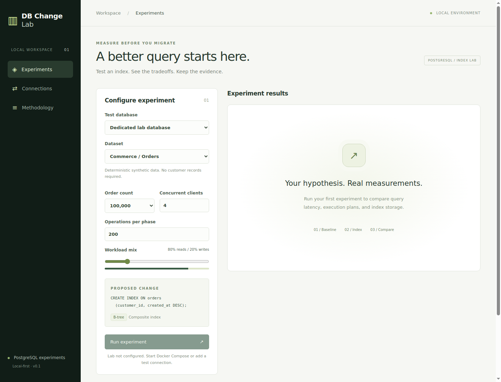
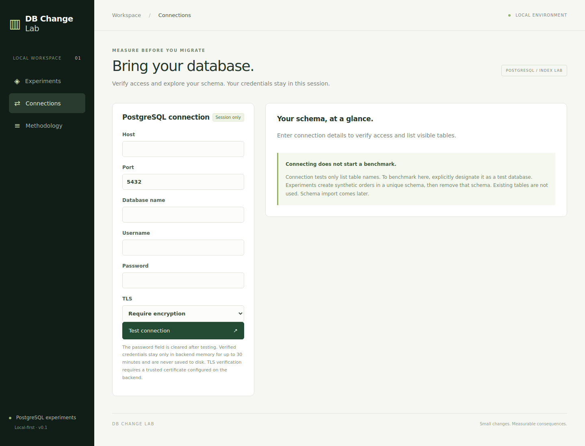

# DB Change Lab

**Test an index. See the tradeoffs. Keep the evidence.**

DB Change Lab is an interactive tool for exploring how an index affects a PostgreSQL workload. It runs the same set of operations before and after adding an index, then shows what changed in query speed, throughput, and storage.

The first version uses generated orders data, so you can try it without supplying customer records.



## Start locally

You need Python 3 and Docker with Docker Compose installed.

```bash
python3 scripts/setup.py
docker compose up --build
```

Open [localhost:8000](http://localhost:8000).

The setup script creates a local database password in an ignored `.env` file. Docker starts the app and its PostgreSQL lab database together. Your experiment history is saved between restarts.

## Run your first experiment

1. Choose how many orders to generate, how many clients should run at once, and the mix of reads and writes.
2. Click **Run experiment**. The app measures the workload, builds the index, and measures it again.
3. Compare latency, operations per second, index size, and build time. Expand **Execution plans** to see how PostgreSQL ran the lookup.
4. Use **Recent experiments** to revisit a previous result.

## Connect a test database

Open **Connections**, enter your PostgreSQL connection details, and click **Test connection**. This checks access and lists visible tables; it does not start an experiment.

To run experiments there, mark it as a test database and choose **Use for experiments**. The account needs permission to create schemas. The app creates its own temporary schema with generated orders and removes it afterward. It does not benchmark or change your existing application tables.

Verified credentials stay in backend memory for a 30-minute session and are never saved to disk. See the [connection guide](docs/development.md#connecting-to-a-database-from-docker) for Docker hostnames and TLS settings.



## What this version covers

This first increment supports one orders dataset and one composite index: `(customer_id, created_at DESC)`. You can change the data size and workload settings, but custom schemas, queries, and indexes come later.

Treat results as evidence to explore, not a prediction of production performance. Inserts are rolled back, so write timings exclude durable commits. The baseline always runs first, so cache effects can influence the comparison. Read [how measurements work](docs/benchmarking.md) before interpreting the results.

The app is intended for one person running it locally. Use a dedicated test database and keep the app bound to localhost.

## For contributors

- **Frontend:** React, TypeScript, and Vite.
- **Backend:** Python and FastAPI, with psycopg for PostgreSQL access.
- **History:** SQLite, stored separately from the database being tested.
- **Checks:** unit/API tests, a real PostgreSQL integration test, frontend formatting and build checks, and a Docker smoke test.

See the [development guide](docs/development.md) for setup, tests, formatting commands, and architecture. Check the latest [CI results](https://github.com/alissaahodge/db-change-lab/actions).

## Next increments

- Repeat trials and alternate run order to make comparisons more reliable.
- Support custom schemas, workloads, and candidate indexes.
- Improve plan comparisons and add result export.
- Add cancellation, more detailed progress, and recovery after interruptions.
